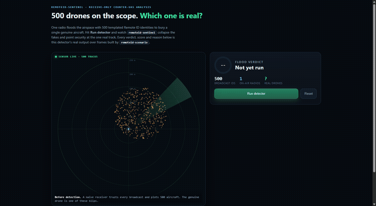

# remoteid-sentinel

**One drone can fake a swarm of hundreds to hide in the noise. This finds the real one.**



[**Live demo**](https://mattbusel.github.io/drone-demos/) &nbsp;·&nbsp;
[](https://crates.io/crates/remoteid-sentinel)
[](https://crates.io/crates/remoteid-sentinel)
[](https://docs.rs/remoteid-sentinel)
[](#license)

Receive-only flood and spoof analysis for counter-UAS sensors. Over the Remote ID broadcasts your sensor has **already received and decoded**, it answers the two questions an operator at an airport, stadium, prison or base is actually asking: is this airspace flooded with fakes, and if one of these is a real drone, which one? It is built directly on the published [`remoteid`](https://crates.io/crates/remoteid) 0.3.3 decoder, so every per-unit judgement is the library's own graded `Assessment`; the sentinel only adds the cross-track signatures that appear when you look at the whole field at once. There is no radio and no transmit path in the crate: it reads verdicts, it never emits RF. Detection logic is exercised against the [`remoteid-scenario`](https://crates.io/crates/remoteid-scenario) sample suite in `tests/`.

## What it answers

1. **Is this airspace flooded with fakes?** A graded `FloodVerdict`: `Clear`, `Elevated` or `Flooded`, with a confidence score.
2. **If one of these is a real drone, which one?** It ranks the surviving tracks and hands you the single one most likely to be a genuine aircraft, with the reasons it was chosen.

Think of it as the analyzer half of an antivirus: your detector decodes, the sentinel grades, and `remoteid-scenario` is the test-sample suite you prove it against.

## Hard boundaries

This crate is **receive-only analysis**. State these when you integrate it.

- **No radio.** It never opens an SDR, a Bluetooth or Wi-Fi adapter, or any other device. It only reads broadcasts your sensor already decoded.
- **No transmit path.** It never broadcasts and emits no RF. It produces a verdict, not a frame.
- **No BLE / Wi-Fi / SDR / HackRF / ESP32 / nRF support**, and no firmware flashing.
- **No instructions for broadcasting into real airspace**, and **no evasion guidance.** Everything here helps a defender grade what was received.

If a change would add a transmit or broadcast capability, it does not belong in this crate.

## What it looks for

Each track carries up its per-unit `remoteid` verdict, and the sentinel raises these cross-track signatures over the field:

| Signature | What it catches | Weight |
|---|---|---|
| `one_source_many_ids` | One on-air address cycling many distinct UAS IDs (fan-out) | 0.8 |
| `tight_rssi_position_cluster` | Dozens of "drones" at one signal strength / one spot: one emitter | 0.6 |
| `templated_serial` | A block of serials sharing a prefix with an incrementing or fixed suffix | 0.7 |
| `frozen_or_identical_counter` | Many "different" drones sharing one frozen or lockstep message counter | 0.7 |
| `impossible_kinematics` | Teleport, impossible speed, or reported speed / course / vertical-rate mismatch (from the library) | 0.9 |
| `shared_operator_position` | One pilot position broadcast under many "different" drones | 0.6 |
| `per_unit_spoofed_or_suspicious` | The library already graded the unit spoofed or suspicious | 0.9 |
| `known_spoofer_fingerprint` | The fingerprint of a known public spoofing tool | 1.0 |
| `count_spike` | A sudden spawn of many new transmitters in one window | 0.4 |

A reason shared by nearly every track in the field (one clock the whole site reads the same way, a common signal floor) is treated as a sensor or environment artifact, not a per-track spoof tell: a flood is multiplicity and strong per-unit evidence, not everyone drifting the same way.

The genuine-track scorer rewards the opposite of a flood: a consistent moving track with sane kinematics, a single stable identity, a serial outside the templated block, a signal distinct from the flood cluster, and, where present, a verified DRIP authentication state.

## Install

```toml
[dependencies]
remoteid-sentinel = "0.1"
```

## Entry points

```rust
use remoteid::{Observation, Transmitter, Transport};
use remoteid_sentinel::{FieldAssessment, FloodLevel};

// `frames` is what your sensor already received and decoded: for each, the
// transmitter it came from and the 25-byte Remote ID payload.
let obs = frames.iter().map(|(tx, payload, rssi, t_ms)| {
    (*tx, Observation::new(Transport::Bluetooth4, None, payload, *t_ms).with_rssi(*rssi))
});
let field = FieldAssessment::from_observations(obs, now_ms);

if field.flood.level == FloodLevel::Flooded {
    if let Some(real) = &field.most_likely_real {
        // Point security at `real.transmitter`; `real.genuine_reasons` says why.
    }
}
```

- `FieldAssessment::from_observations` replays a stream of already-decoded observations through a `remoteid::Tracker` and keeps the cross-track history the tracker discards (per-source fan-out, counter sequences). Prefer this when you have the raw decoded stream.
- `FieldAssessment::from_tracker` analyzes a `Tracker` you already maintain. It works from the tracker's final state, so the fan-out and shared-counter checks that need the full history are only partially visible.

Both drive `remoteid`'s own tracker and trust state, so per-unit grading is exactly what the library would produce.

## Configuration

`FieldConfig` passes a `remoteid::TrustConfig` straight through for per-unit grading and exposes the thresholds for the field signatures: the count-spike window and minimum, the per-source fan-out minimum, the RSSI cluster width and minimum, the serial-template group size, the operator co-location minimum, and `requires_auth` (off by default, since almost no aircraft flying today sign; turn it on only where every legitimate operator in the protected volume is known to authenticate).

## License

MIT OR Apache-2.0.
